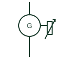

# Variable-slip wind turbine generator (Type 2)

A wind turbine using a wound-rotor induction generator with controlled external rotor resistance to widen the slip range.

[Canonical reference](https://eloragrid.ai/symbols/type-2-variable-slip-wind-turbine-generator) · [Structured record](../entries/type-2-variable-slip-wind-turbine-generator.json) · [All references](README.md)

Updated: 2026-10-28. Drawing use: SLD, Schematic. Reference families: IEC, IEEE / ANSI.

## What it represents

A Type 2 wind turbine uses a wound-rotor induction generator whose rotor circuit is connected to a variable resistance, usually switched by power electronics mounted on the rotor. Raising the rotor resistance lets the slip increase to around ten per cent, which softens torque peaks from gusts while the stator stays connected directly to the network.
Drawings show the generator circle with rotor slip-ring or rotor-winding marks and a resistor element with a variable arrow attached to the rotor side. The stator side follows the same path as a Type 1 machine: soft starter, capacitor compensation and step-up transformer.
Energy dissipated in the rotor resistance is lost as heat, so the symbol says nothing about efficiency or about any capability to deliver reactive power. Fault ride-through behaviour and resistor ratings must be read from the turbine model data.

## How to read it

- The variable resistor on the rotor side is a slip control element, not a braking resistor or a load.
- Stator-side compensation capacitors are still normally present.

## Drawing checklist

- State rotor resistance control range.
- Show stator connection and compensation.
- Reference turbine model data for dynamic studies.

## Important distinction

A Type 2 turbine dissipates rotor energy in resistance; a doubly-fed generator returns rotor power to the network through a converter.

## Facts

- Generator type: Wound-rotor induction
- Speed control: Rotor resistance, limited slip range
- Converter in power path: None in stator path
- Preview: Independent educational illustration; consult the applicable standard and project legend for the exact graphic

## Public references

- [AutoCAD Electrical: Power station and substation concepts](https://help.autodesk.com/cloudhelp/2021/ENU/AutoCAD-Electrical/files/GUID-74EF80E8-018D-4A57-88BD-FF973F1B8185.htm) — Autodesk. Wind station representation used as site-level context.
- [Resistors and heater-element symbols](https://help.autodesk.com/cloudhelp/2021/ENU/AutoCAD-Electrical/files/GUID-1D071951-D38E-4B15-8B9E-C30ECBD55C19.htm) — Autodesk. Public variable-resistor symbol context for the rotor resistance element.

## Related references

- [Wound-rotor induction motor](wound-rotor-induction-motor.md)
- [Fixed-speed wind turbine generator (Type 1)](type-1-fixed-speed-wind-turbine-generator.md)
- [Doubly-fed induction generator](doubly-fed-induction-generator.md)
- [Variable resistor](variable-resistor.md)

Original educational concept geometry, CC BY 4.0. Unitless; not a certified standards glyph or manufacturer footprint.

Elora-authored explanations are CC BY 4.0. Linked standards and manufacturer material retain their own rights. Confirm project requirements using primary sources.
