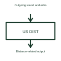

# Ultrasonic distance sensor

An ultrasonic distance sensor uses sound beyond normal human hearing to obtain distance information.

[Canonical reference](https://eloragrid.ai/symbols/ultrasonic-distance-sensor) · [Structured record](../entries/ultrasonic-distance-sensor.json) · [All references](README.md)

Updated: 2026-10-27. Drawing use: Schematic. Reference families: Manufacturer.

## What it represents

An ultrasonic distance sensor uses sound beyond normal human hearing to obtain distance information.
A sensing system can time a returned echo from a target within its specified operating conditions.
Show the sound path to the target and the returned echo as measurement roles, not electrical terminals. Time-of-flight arrangements derive distance from travel time under their specified conditions. Identify the medium and target so the drawing does not imply that one installation works through every obstacle or environment. This is original functional artwork, not a certified standard graphic or device pinout.

## How to read it

- Identify target, medium and intended sensing direction.
- Reference mounting and unusable near-range conditions.
- Show the actual electrical output interface separately.
- Target shape, medium and installation affect the measurement; the block does not specify a guaranteed range.

## Drawing checklist

- Identify target, medium and intended sensing direction.
- Reference mounting and unusable near-range conditions.
- Show the actual electrical output interface separately.

## Important distinction

Target shape, medium and installation affect the measurement; the block does not specify a guaranteed range.

## Facts

- Representation type: Original functional block; not a certified IEC or IEEE graphic
- Concept input: Outgoing sound and echo
- Concept output: Distance-related output

## Public references

- [Ultrasonic measurement processing example](https://www.ti.com/product/PGA460) — Texas Instruments. Primary-source technical context for this particular function; product-specific ratings remain with the manufacturer.

## Related references

- [Temperature measuring transducer](temperature-measuring-transducer.md)
- [Hall-effect current sensor](hall-effect-current-sensor.md)
- [Magnetic position sensor](magnetic-position-sensor.md)
- [Inductive position sensor](inductive-position-sensor.md)

Original educational concept geometry, CC BY 4.0. Unitless; not a certified standards glyph or manufacturer footprint.

Elora-authored explanations are CC BY 4.0. Linked standards and manufacturer material retain their own rights. Confirm project requirements using primary sources.
