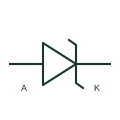

# Unidirectional TVS diode

A transient-suppression diode intended to clamp a documented surge polarity across a protected circuit.

[Canonical reference](https://eloragrid.ai/symbols/unidirectional-tvs-diode) · [Structured record](../entries/unidirectional-tvs-diode.json) · [All references](README.md)

Updated: 2026-10-27. Drawing use: Schematic. Reference families: Manufacturer.

## What it represents

A transient-suppression diode intended to clamp a documented surge polarity across a protected circuit.
On a schematic, identify cathode orientation and the protected supply/signal node and trace the transient diversion path and return conductor. Keep the component tag and signal/reference names consistent across the control drawing, terminal schedule and device documentation.
A TVS clamping rating is not the normal working voltage; unidirectional and bidirectional devices have different polarity behaviour.
Terminal letters describe electrical roles, not package pin numbers. Check the selected public datasheet for the actual pin assignment, polarity and any internally connected terminals before completing the drawing.

## How to read it

- Identify cathode orientation and the protected supply/signal node.
- Trace the transient diversion path and return conductor.

## Drawing checklist

- Label cathode orientation and the protected supply/signal node.
- Cross-reference the transient diversion path and return conductor.
- Add the selected device or circuit documentation revision, power/reference connections and project signal convention.

## Important distinction

A TVS clamping rating is not the normal working voltage; unidirectional and bidirectional devices have different polarity behaviour.

## Facts

- Common schematic mnemonic: TVS — descriptive only; project/device documentation defines reference designations.
- Terminal / interface focus: Cathode orientation and the protected supply/signal node
- Artwork scope: Original educational component glyph; not a certified standard graphic or package pinout.

## Public references

- [ESD protection and TVS device families](https://www.nexperia.com/products/esd-protection-tvs-filtering-and-signal-conditioning) — Nexperia. Public primary manufacturer documentation establishes the component function or circuit/topology relationship. Preview geometry and drafting explanations are independently authored.

## Related references

- [Bidirectional breakdown diode](bidirectional-breakdown-diode.md)
- [Diode](diode.md)

Original educational concept geometry, CC BY 4.0. Unitless; not a certified standards glyph or manufacturer footprint.

Elora-authored explanations are CC BY 4.0. Linked standards and manufacturer material retain their own rights. Confirm project requirements using primary sources.
