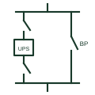

# UPS maintenance bypass

An arrangement of interlocked switches that routes the load around a UPS so the UPS can be isolated for work.

[Canonical reference](https://eloragrid.ai/symbols/ups-maintenance-bypass) · [Structured record](../entries/ups-maintenance-bypass.json) · [All references](README.md)

Updated: 2026-10-28. Drawing use: SLD. Reference families: IEC, IEEE / ANSI.

## What it represents

A UPS maintenance bypass is a set of switches, usually input, output and bypass, that lets the load be connected directly to the bypass supply while the UPS is fully isolated. It is normally external to the UPS cabinet so that the UPS itself can be removed without disturbing the load wiring.
Single-line diagrams show the UPS between an input switch and an output switch, with a bypass switch connecting the input supply directly to the output busbar. Key interlocks or a make-before-break sequence prevent the UPS inverter from being paralleled with an unsynchronised bypass.
The symbol does not tell you the sequence of operation or whether the UPS static bypass must be engaged first. Those steps are critical and must be written on the operating label or switching instruction.

## How to read it

- Identify the three switches and their interlock.
- The bypass source may differ from the UPS rectifier source.

## Drawing checklist

- State ratings of each switch.
- Show interlocks.
- Reference operating sequence.

## Important distinction

A maintenance bypass is external switching around the whole UPS; the static bypass is an internal electronic path.

## Facts

- Switches: Input, output and bypass
- Location: Usually external to the UPS
- Interlock: Key or sequenced
- Preview: Independent educational illustration; consult the applicable standard and project legend for the exact graphic

## Public references

- [DC UPS, AC UPS and capacitor buffer modules](https://www.phoenixcontact.com/en-gb/products/uninterruptible-power-supplies-ups) — Phoenix Contact. Public UPS function context.
- [IEC graphical symbols for diagrams](https://tc3.iec.ch/tc-activity/graphical-symbols-for-diagrams/) — IEC. IEC graphical symbol context for switches.

## Related references

- [Online double-conversion UPS](online-double-conversion-ups.md)
- [UPS maintenance bypass panel](ga-ups-maintenance-bypass-panel.md)
- [Bypass-isolation transfer switch](bypass-isolation-transfer-switch.md)
- [Switch-disconnector](switch-disconnector.md)

Original educational concept geometry, CC BY 4.0. Unitless; not a certified standards glyph or manufacturer footprint.

Elora-authored explanations are CC BY 4.0. Linked standards and manufacturer material retain their own rights. Confirm project requirements using primary sources.
