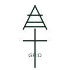

# Utility grid connection

The symbol for the external utility network as a supply source at the top of a single-line diagram.

[Canonical reference](https://eloragrid.ai/symbols/utility-grid-connection) · [Structured record](../entries/utility-grid-connection.json) · [All references](README.md)

Updated: 2026-10-28. Drawing use: SLD. Reference families: IEC, IEEE / ANSI.

## What it represents

The utility grid connection symbol represents the public supply network as seen from the installation. It is drawn at the top or edge of a single-line diagram to show where power enters, and in a microgrid it is one of several sources, typically the reference source when the microgrid is grid-connected.
Common forms include a lattice tower glyph, a circle with a sine wave, a set of arrows into the busbar or a box labelled UTILITY or GRID. Voltage, prospective fault level and earthing system of the supply are written beside it.
The symbol does not show the network operator protection or reclose behaviour, which affects whether downstream generation must disconnect quickly. Those details come from the connection agreement and are usually noted on the drawing.

## How to read it

- Read the fault level and X/R ratio noted beside the source.
- The earthing system of the supply affects downstream design.

## Drawing checklist

- State voltage, fault level and earthing system.
- Show incoming protection and metering.
- Reference connection agreement.

## Important distinction

A utility connection represents the external network; a grid equivalent source is a study model with defined impedance.

## Facts

- Represents: External supply network
- Annotations: Voltage, fault level, earthing system
- Microgrid role: Reference source when connected
- Preview: Independent educational illustration; consult the applicable standard and project legend for the exact graphic

## Public references

- [AutoCAD Electrical: Earthing, sources and surge protection](https://help.autodesk.com/cloudhelp/2021/ENU/AutoCAD-Electrical/files/GUID-1E3FDEAE-B4B2-417C-8075-108AA2C6E509.htm) — Autodesk. Public earthing and source symbol context.
- [Electrical installation design methodology and references](https://www.electrical-installation.org/enwiki/General_rules_of_electrical_installation_design) — Schneider Electric — Electrical Installation Guide. Public electrical installation design references covering supply characteristics.

## Related references

- [Point of common coupling](point-of-common-coupling.md)
- [Grid equivalent source](grid-equivalent-source.md)
- [Three-phase AC source](three-phase-ac-source.md)
- [Substation](substation.md)

Original educational concept geometry, CC BY 4.0. Unitless; not a certified standards glyph or manufacturer footprint.

Elora-authored explanations are CC BY 4.0. Linked standards and manufacturer material retain their own rights. Confirm project requirements using primary sources.
