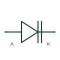

# Varactor diode

A reverse-biased diode whose junction capacitance is used as a voltage-controlled circuit element.

[Canonical reference](https://eloragrid.ai/symbols/varactor-diode) · [Structured record](../entries/varactor-diode.json) · [All references](README.md)

Updated: 2026-10-27. Drawing use: Schematic. Reference families: Manufacturer.

## What it represents

A reverse-biased diode whose junction capacitance is used as a voltage-controlled circuit element.
On a schematic, identify the tuning bias, cathode orientation and RF node and trace the tuned or phase-control circuit. Keep the component tag and signal/reference names consistent across the control drawing, terminal schedule and device documentation.
A varactor uses junction capacitance under reverse bias; it is not an adjustable mechanical capacitor.
Terminal letters describe electrical roles, not package pin numbers. Check the selected public datasheet for the actual pin assignment, polarity and any internally connected terminals before completing the drawing.

## How to read it

- Identify the tuning bias, cathode orientation and RF node.
- Trace the tuned or phase-control circuit.

## Drawing checklist

- Label the tuning bias, cathode orientation and RF node.
- Cross-reference the tuned or phase-control circuit.
- Add the selected device or circuit documentation revision, power/reference connections and project signal convention.

## Important distinction

A varactor uses junction capacitance under reverse bias; it is not an adjustable mechanical capacitor.

## Facts

- Common schematic mnemonic: VAR — descriptive only; project/device documentation defines reference designations.
- Terminal / interface focus: The tuning bias, cathode orientation and RF node
- Artwork scope: Original educational component glyph; not a certified standard graphic or package pinout.

## Public references

- [BB181 variable-capacitance diode documentation](https://www.nxp.com/docs/en/data-sheet/BB181.pdf) — NXP Semiconductors. Public primary manufacturer documentation establishes the component function or circuit/topology relationship. Preview geometry and drafting explanations are independently authored.

## Related references

- [Adjustable capacitor](adjustable-capacitor.md)
- [Diode](diode.md)

Original educational concept geometry, CC BY 4.0. Unitless; not a certified standards glyph or manufacturer footprint.

Elora-authored explanations are CC BY 4.0. Linked standards and manufacturer material retain their own rights. Confirm project requirements using primary sources.
