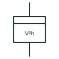

# Volt-squared-hour meter

Integrating meter that totalises the square of voltage over time, used to assess voltage-dependent losses and stress.

[Canonical reference](https://eloragrid.ai/symbols/volt-squared-hour-meter) · [Structured record](../entries/volt-squared-hour-meter.json) · [All references](README.md)

Updated: 2026-10-28. Drawing use: Schematic. Reference families: IEC.

## What it represents

A volt-squared-hour meter integrates the square of voltage over time. Quantities such as iron losses in transformers and the stress on some insulation vary roughly with voltage squared, so the register gives a measure of exposure that a simple time-at-voltage record would not.
It is uncommon on modern drawings and is often provided as a calculated register inside a multifunction meter. The symbol does not tell you the reference voltage or whether the value is per phase or combined, so the meter documentation is needed to use the reading.

## How to read it

- Check whether the value is per phase or combined.
- Confirm whether this is a separate meter or a calculated register.

## Drawing checklist

- Show VT source
- State reference voltage
- Reference meter documentation

## Important distinction

A V²h meter integrates voltage squared; a kWh meter integrates power.

## Facts

- Integrated quantity: Voltage squared over time
- Typical use: Loss and stress assessment
- Preview: Independent educational concept; consult the applicable standard and project legend for the exact graphic

## Public references

- [IEC graphical symbols for diagrams](https://tc3.iec.ch/tc-activity/graphical-symbols-for-diagrams/) — IEC. IEC context for graphical symbols used in diagrams; no IEC graphic is reproduced.

## Related references

- [Integrating instrument general symbol](integrating-instrument-general-symbol.md)
- [Ampere-hour meter](ampere-hour-meter.md)
- [Recording voltmeter](recording-voltmeter.md)

Original educational concept geometry, CC BY 4.0. Unitless; not a certified standards glyph or manufacturer footprint.

Elora-authored explanations are CC BY 4.0. Linked standards and manufacturer material retain their own rights. Confirm project requirements using primary sources.
