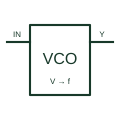

# Voltage-controlled oscillator

Generates an oscillating output whose frequency responds to the documented control voltage.

[Canonical reference](https://eloragrid.ai/symbols/voltage-controlled-oscillator) · [Structured record](../entries/voltage-controlled-oscillator.json) · [All references](README.md)

Updated: 2026-10-27. Drawing use: Schematic. Reference families: Manufacturer.

## What it represents

Generates an oscillating output whose frequency responds to the documented control voltage.
On a schematic, identify the control input, supply/reference and timing components and trace the oscillator output and downstream clock or modulation circuit. Keep the component tag and signal/reference names consistent across the control drawing, terminal schedule and device documentation.
A VCO is a signal generator; the term does not mean a power-frequency generator connected to a busbar.
The preview is an independently drawn educational functional reference. Add the selected component’s actual power pins, terminal numbers, timing or analogue reference details when producing a construction drawing.

## How to read it

- Identify the control input, supply/reference and timing components.
- Trace the oscillator output and downstream clock or modulation circuit.

## Drawing checklist

- Label the control input, supply/reference and timing components.
- Cross-reference the oscillator output and downstream clock or modulation circuit.
- Add the selected device or circuit documentation revision, power/reference connections and project signal convention.

## Important distinction

A VCO is a signal generator; the term does not mean a power-frequency generator connected to a busbar.

## Facts

- Common schematic mnemonic: VCO — descriptive only; project/device documentation defines reference designations.
- Terminal / interface focus: The control input, supply/reference and timing components
- Artwork scope: Original educational functional/circuit reference; not a selected product pinout.

## Public references

- [CD4046B — phase-locked loops and voltage-controlled oscillators](https://www.ti.com/product/CD4046B) — Texas Instruments. Public primary manufacturer documentation establishes the component function or circuit/topology relationship. Preview geometry and drafting explanations are independently authored.

## Related references

- [Phase-locked loop](phase-locked-loop.md)
- [PLC input / output](plc-io.md)

Original educational concept geometry, CC BY 4.0. Unitless; not a certified standards glyph or manufacturer footprint.

Elora-authored explanations are CC BY 4.0. Linked standards and manufacturer material retain their own rights. Confirm project requirements using primary sources.
