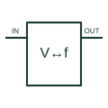

# Voltage / frequency converter

Converts between an analogue voltage and a pulse-frequency representation in the documented selected configuration.

[Canonical reference](https://eloragrid.ai/symbols/voltage-frequency-converter) · [Structured record](../entries/voltage-frequency-converter.json) · [All references](README.md)

Updated: 2026-10-27. Drawing use: Schematic. Reference families: Manufacturer.

## What it represents

Converts between an analogue voltage and a pulse-frequency representation in the documented selected configuration.
On a schematic, identify the signal input, conversion direction and timing/scaling network and trace the pulse or analogue output and its receiving interface. Keep the component tag and signal/reference names consistent across the control drawing, terminal schedule and device documentation.
The drawing must state the selected direction; the same component family may support V-to-F and F-to-V through different external connections.
The preview is an independently drawn educational functional reference. Add the selected component’s actual power pins, terminal numbers, timing or analogue reference details when producing a construction drawing.

## How to read it

- Identify the signal input, conversion direction and timing/scaling network.
- Trace the pulse or analogue output and its receiving interface.

## Drawing checklist

- Label the signal input, conversion direction and timing/scaling network.
- Cross-reference the pulse or analogue output and its receiving interface.
- Add the selected device or circuit documentation revision, power/reference connections and project signal convention.

## Important distinction

The drawing must state the selected direction; the same component family may support V-to-F and F-to-V through different external connections.

## Facts

- Common schematic mnemonic: V/F — descriptive only; project/device documentation defines reference designations.
- Terminal / interface focus: The signal input, conversion direction and timing/scaling network
- Artwork scope: Original educational functional/circuit reference; not a selected product pinout.

## Public references

- [AD650 — voltage/frequency conversion](https://www.analog.com/en/products/ad650.html) — Analog Devices. Public primary manufacturer documentation establishes the component function or circuit/topology relationship. Preview geometry and drafting explanations are independently authored.

## Related references

- [Frequency meter](frequency-meter.md)
- [PLC input / output](plc-io.md)

Original educational concept geometry, CC BY 4.0. Unitless; not a certified standards glyph or manufacturer footprint.

Elora-authored explanations are CC BY 4.0. Linked standards and manufacturer material retain their own rights. Confirm project requirements using primary sources.
