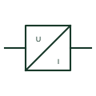

# Voltage measuring transducer

Transducer that converts a VT secondary or direct voltage into an isolated analogue signal for remote measurement.

[Canonical reference](https://eloragrid.ai/symbols/voltage-measuring-transducer) · [Structured record](../entries/voltage-measuring-transducer.json) · [All references](README.md)

Updated: 2026-10-28. Drawing use: Schematic. Reference families: IEC, Manufacturer.

## What it represents

A voltage measuring transducer converts a voltage into a standard analogue signal such as 4-20 mA, with galvanic isolation between input and output. It is fed from a VT secondary or, at low voltage, directly from the busbar through fuses, and it supplies a PLC, SCADA or regulator input.
The symbol does not show whether the output follows RMS or average value, or the live zero of the output range. If the transducer is self-powered from the measured voltage, its output fails when the voltage collapses, which matters when it is used to detect loss of supply.

## How to read it

- Check whether the transducer has a separate auxiliary supply.
- Confirm the output range and live zero.

## Drawing checklist

- Show input fusing
- State input and output ranges
- Reference receiving input

## Important distinction

A voltage transducer provides a signal to other equipment; a voltmeter displays the reading locally.

## Facts

- Input: VT secondary or direct voltage
- Output: Isolated analogue signal
- Preview: Independent educational concept; consult the applicable standard and project legend for the exact graphic

## Public references

- [Analog current signal isolation](https://www.phoenixcontact.com/en-us/products/signal-conditioner-mcr-c-i-i-0b-0b-dci-2810955) — Phoenix Contact. Public context for isolated analogue measuring signals.
- [IEC graphical symbols for diagrams](https://tc3.iec.ch/tc-activity/graphical-symbols-for-diagrams/) — IEC. IEC context for graphical symbols used in diagrams; no IEC graphic is reproduced.

## Related references

- [Active-power transducer](active-power-transducer.md)
- [Voltage transformer](voltage-transformer.md)
- [Single-phase AC-to-DC current converter](iec-single-phase-ac-to-dc-current-converter.md)

Original educational concept geometry, CC BY 4.0. Unitless; not a certified standards glyph or manufacturer footprint.

Elora-authored explanations are CC BY 4.0. Linked standards and manufacturer material retain their own rights. Confirm project requirements using primary sources.
