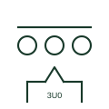

# Voltage transformer set with broken-delta residual winding

Three single-phase VTs whose residual windings are connected in broken delta to produce the zero-sequence voltage.

[Canonical reference](https://eloragrid.ai/symbols/voltage-transformer-with-residual-winding) · [Structured record](../entries/voltage-transformer-with-residual-winding.json) · [All references](README.md)

Updated: 2026-10-28. Drawing use: SLD, Schematic. Reference families: IEC, Manufacturer.

## What it represents

In this arrangement three single-phase earthed VTs each carry a residual winding, and the three residual windings are connected in series as a broken delta. In a healthy balanced system the voltage across the open corner is near zero, and during an earth fault it rises towards three times the zero-sequence voltage, which feeds residual voltage and directional earth-fault elements.
A damping resistor is often connected across the broken delta to suppress ferroresonance in isolated or resonant-earthed networks. The symbol does not show that resistor or the earthing of the VT primaries, both of which need explicit detail on the schematic.

## How to read it

- Check the primaries are earthed star so zero sequence can be measured.
- Look for a damping resistor across the open corner.

## Drawing checklist

- Show broken-delta connection
- Show damping resistor if fitted
- Reference residual voltage relay input

## Important distinction

A broken-delta winding measures residual voltage; an open-delta (V-V) connection measures line voltages with two VTs.

## Facts

- Output: Residual (zero-sequence) voltage
- Primaries: Earthed star
- Preview: Independent educational concept; consult the applicable standard and project legend for the exact graphic

## Public references

- [Indoor current and voltage transformers](https://www.abb.com/gb/en/areas/electrification/medium-voltage/grid-components/core-components/indoor-instrument-transformers) — ABB. Public manufacturer overview of indoor current and voltage instrument transformers.
- [Residual current and neutral-earthing protection context](https://new.abb.com/medium-voltage/digital-substations/campaigns/earth-fault-protection-portfolio/earth-fault-offering) — ABB. Public context for residual quantities and neutral-earthing protection.

## Related references

- [Residual-voltage monitoring relay](residual-voltage-monitoring-relay.md)
- [Open-delta voltage transformer connection](open-delta-voltage-transformer-connection.md)
- [Voltage transformer](voltage-transformer.md)

Original educational concept geometry, CC BY 4.0. Unitless; not a certified standards glyph or manufacturer footprint.

Elora-authored explanations are CC BY 4.0. Linked standards and manufacturer material retain their own rights. Confirm project requirements using primary sources.
