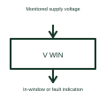

# Window voltage supervisor

A window supervisor checks whether a monitored voltage stays between its specified lower and upper limits.

[Canonical reference](https://eloragrid.ai/symbols/window-voltage-supervisor) · [Structured record](../entries/window-voltage-supervisor.json) · [All references](README.md)

Updated: 2026-10-27. Drawing use: Schematic. Reference families: Manufacturer.

## What it represents

A window supervisor checks whether a monitored voltage stays between its specified lower and upper limits.
A circuit can indicate both an undervoltage and an overvoltage condition using the selected supervisor.
Show the monitored voltage together with its lower and upper acceptable limits in the documentation. The window function checks both sides of that range. Label whether the output represents an in-window condition or a fault so the meaning is not reversed by an ambiguous signal name. This is original functional artwork, not a certified standard graphic or device pinout.

## How to read it

- Identify the monitored voltage and both limits.
- Define the output’s in-window or fault meaning.
- Reference timing and hysteresis where provided.
- The permitted window and response time must be specified independently of the symbol.

## Drawing checklist

- Identify the monitored voltage and both limits.
- Define the output’s in-window or fault meaning.
- Reference timing and hysteresis where provided.

## Important distinction

The permitted window and response time must be specified independently of the symbol.

## Facts

- Representation type: Original functional block; not a certified IEC or IEEE graphic
- Concept input: Monitored supply voltage
- Concept output: In-window or fault indication

## Public references

- [Supply supervision and reset](https://www.ti.com/product-category/power-management/supervisor-reset-ics/overview.html) — Texas Instruments. Supply supervision and reset: public technical context for the named function. Product and compliance details remain with the publisher.

## Related references

- [Watchdog timer](watchdog-timer.md)
- [Supply voltage supervisor](supply-voltage-supervisor.md)
- [Power-good indication](power-good-indication.md)
- [Power converter / inverter](power-converter.md)

Original educational concept geometry, CC BY 4.0. Unitless; not a certified standards glyph or manufacturer footprint.

Elora-authored explanations are CC BY 4.0. Linked standards and manufacturer material retain their own rights. Confirm project requirements using primary sources.
