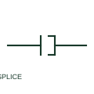

# Wire splice

A wire splice intentionally joins documented conductors without a detachable connector interface.

[Canonical reference](https://eloragrid.ai/symbols/wire-splice) · [Structured record](../entries/wire-splice.json) · [All references](README.md)

Updated: 2026-10-27. Drawing use: Schematic. Reference families: IEC, Manufacturer.

## What it represents

A wire splice intentionally joins documented conductors without a detachable connector interface. The schematic shows electrical continuity and the harness or wiring record identifies the actual splice construction.

## How to read it

- Distinguish the intended splice node from a crossing of unconnected wires.
- The preview is an original explanation of this function. Match the actual drawing convention to its legend and the selected equipment documentation.

## Drawing checklist

- Name splice identifier
- List joined conductors
- Reference construction detail

## Important distinction

A splice is a permanent wiring junction, whereas a connector provides a detachable mating interface.

## Facts

- Drawing role: Detachable connection
- Representation scope: Functional concept; not an official standard graphic or a product footprint
- Public vendor block reference: HSP1001, VSP1001 (Autodesk identifiers; not IEC symbol numbers)
- Identifier status: The short label is a functional lookup label, not an assigned IEC or IEEE symbol number. Any separately listed Autodesk code is a verified vendor block name.

## Public references

- [AutoCAD Electrical: Splice symbols](https://help.autodesk.com/cloudhelp/2021/ENU/AutoCAD-Electrical/files/GUID-4853BC4B-36BF-44A7-A73C-A95A3A4C58EA.htm) — Autodesk. Public documentation of this equipment function or named vendor variant; the illustration is independently authored and is not the source graphic.

## Related references

- [Terminal connection](terminal.md)
- [PLC input / output](plc-io.md)

Original educational concept geometry, CC BY 4.0. Unitless; not a certified standards glyph or manufacturer footprint.

Elora-authored explanations are CC BY 4.0. Linked standards and manufacturer material retain their own rights. Confirm project requirements using primary sources.
