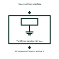

# Yard fence bonding interface

Identifies the assigned connection or isolation treatment of the yard fence in the earthing design.

[Canonical reference](https://eloragrid.ai/symbols/yard-fence-bonding-interface) · [Structured record](../entries/yard-fence-bonding-interface.json) · [All references](README.md)

Updated: 2026-11-03. Drawing use: Schematic. Reference families: Manufacturer.

Representation: functional-block; installation focus: switchyards.
Fence earthing interface
Documented fence treatment

## What it represents

Identifies the assigned connection or isolation treatment of the yard fence in the earthing design. Earthing and lightning interfaces identify the connections between equipment metalwork, primary protection devices and the station earthing network. Their electrical purpose differs from their physical conductor route or electrode geometry.
In a switchyard arrangement, the earthing references help connect each primary equipment structure and surge-protection device to the correct earth-grid interface. Separate details show actual joints, sizes and installation routes. For this reference, the drawing identifies “Fence earthing interface” at the input and “Documented fence treatment” at the output. Fence treatment is site-specific.
Name every connected item and the earthing design reference. The illustrative connection does not establish touch or step voltages, conductor sizing, lightning coverage or safe working conditions. The functional block is an independent explanation of this named application. Equipment-specific ratings, terminal connections and operating conditions must be established in the project documentation.

## How to read it

- Start at the named input: Fence earthing interface. Identify its source device or document and the state represented on the drawing.
- Follow the named output: Documented fence treatment. Cross-reference its destination and separate the command from confirmation that the equipment responded.
- Fence treatment is site-specific.
- Name every connected item and the earthing design reference. The illustrative connection does not establish touch or step voltages, conductor sizing, lightning coverage or safe working conditions.

## Drawing checklist

- Label the source and connection reference for fence earthing interface.
- Identify the destination and defined state of documented fence treatment.
- Record the equipment or control-document revision supporting this functional block.
- Check this application limit in the project design: Fence treatment is site-specific.

## Important distinction

Fence treatment is site-specific. This reference describes the named application; it does not establish a new IEC graphical symbol, an ANSI device-function number or an exact manufacturer connection diagram.

## Facts

- Representation: Functional block
- Installation focus: Switchyards
- Input / boundary: Fence earthing interface
- Output / connection: Documented fence treatment
- Lookup label: YFBI is a library lookup label, not a standard device designation.

## Public references

- [Earthing connections](https://www.electrical-installation.org/enwiki/Earthing_connections) — Schneider Electric, Electrical Installation Guide. Public technical context for switchyard earthing and lightning interfaces. Protective earthing, bonding and earth-electrode interfaces. The application text and educational graphic are independently authored; the publisher does not certify this representation.

## Related references

- [Earth electrode](iec-earth-electrode.md)
- [Lightning protection down-conductor](lightning-down-conductor.md)
- [Yard gate bonding interface](yard-gate-bonding-interface.md)

Original educational concept geometry, CC BY 4.0. Unitless; not a certified standards glyph or manufacturer footprint.

Elora-authored explanations are CC BY 4.0. Linked standards and manufacturer material retain their own rights. Confirm project requirements using primary sources.
