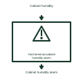

# Yard terminal-cabinet humidity alarm

Identifies the measured humidity condition used by the selected cabinet supervisory function.

[Canonical reference](https://eloragrid.ai/symbols/yard-terminal-cabinet-humidity-alarm) · [Structured record](../entries/yard-terminal-cabinet-humidity-alarm.json) · [All references](README.md)

Updated: 2026-11-03. Drawing use: Schematic. Reference families: Manufacturer.

Representation: functional-block; installation focus: switchyards.
Cabinet humidity
Cabinet humidity alarm

## What it represents

Identifies the measured humidity condition used by the selected cabinet supervisory function. Yard equipment supervision carries the condition and support-system information of primary equipment into station alarms. A monitor's declared alarm, measurement and self-fault output need separate point names.
In a switchyard marshalling kiosk, gas compartment, operating mechanism and cabinet-service indications are collected for the station controller. Their equipment tags identify the actual compartment or mechanism being monitored. For this reference, the drawing identifies “Cabinet humidity” at the input and “Cabinet humidity alarm” at the output. The sensor covers a defined local environment.
Keep primary-device identity, compartment boundaries and monitor health visible. A monitoring illustration does not establish a leak rate, operating threshold or remaining equipment life. The functional block is an independent explanation of this named application. Equipment-specific ratings, terminal connections and operating conditions must be established in the project documentation.

## How to read it

- Start at the named input: Cabinet humidity. Identify its source device or document and the state represented on the drawing.
- Follow the named output: Cabinet humidity alarm. Cross-reference its destination and separate the command from confirmation that the equipment responded.
- The sensor covers a defined local environment.
- Keep primary-device identity, compartment boundaries and monitor health visible. A monitoring illustration does not establish a leak rate, operating threshold or remaining equipment life.

## Drawing checklist

- Label the source and connection reference for cabinet humidity.
- Identify the destination and defined state of cabinet humidity alarm.
- Record the equipment or control-document revision supporting this functional block.
- Check this application limit in the project design: The sensor covers a defined local environment.

## Important distinction

The sensor covers a defined local environment. This reference describes the named application; it does not establish a new IEC graphical symbol, an ANSI device-function number or an exact manufacturer connection diagram.

## Facts

- Representation: Functional block
- Installation focus: Switchyards
- Input / boundary: Cabinet humidity
- Output / connection: Cabinet humidity alarm
- Lookup label: YTHA is a library lookup label, not a standard device designation.

## Public references

- [Modular switchgear monitoring](https://www.hitachienergy.com/in/en/products-and-solutions/high-voltage-switchgear-and-breakers/monitoring-and-controlled-switching/modular-switchgear-monitoring-msm) — Hitachi Energy. Public technical context for switchyard equipment condition interfaces. Gas, operating mechanism and circuit-breaker condition monitoring. The application text and educational graphic are independently authored; the publisher does not certify this representation.

## Related references

- [Partial discharge sensor](partial-discharge-sensor.md)
- [Substation RTU](ga-substation-rtu.md)
- [Yard mechanism anti-condensation interface](yard-mechanism-anti-condensation-interface.md)

Original educational concept geometry, CC BY 4.0. Unitless; not a certified standards glyph or manufacturer footprint.

Elora-authored explanations are CC BY 4.0. Linked standards and manufacturer material retain their own rights. Confirm project requirements using primary sources.
